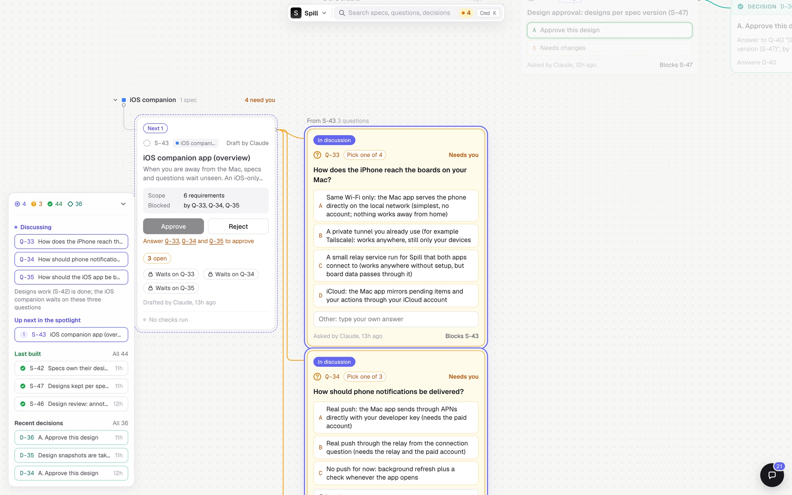
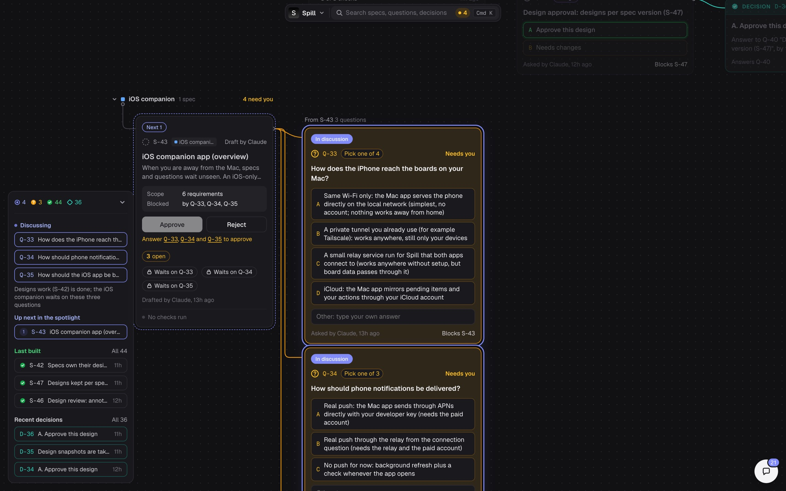
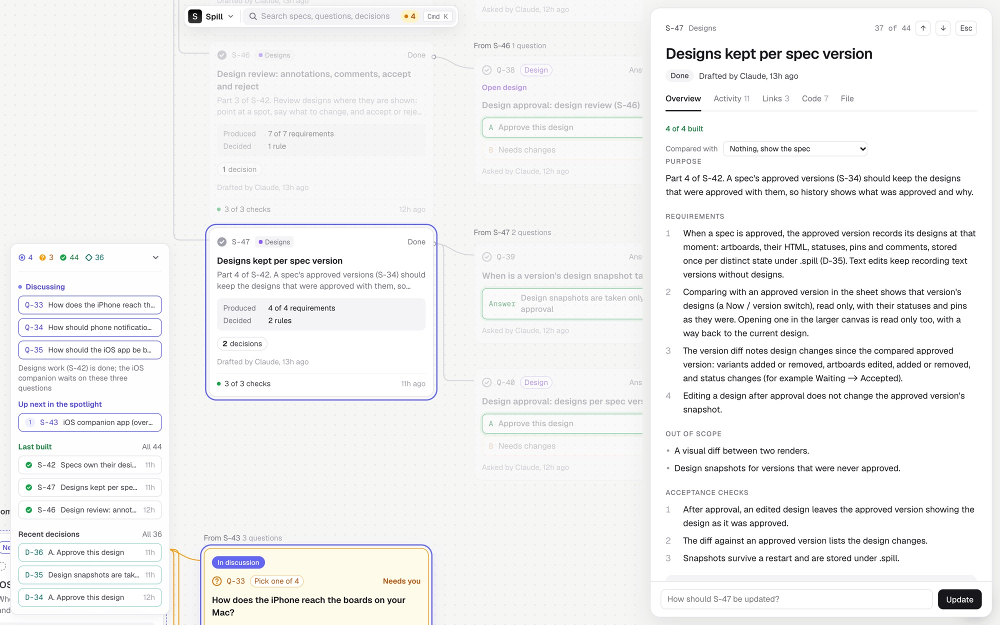
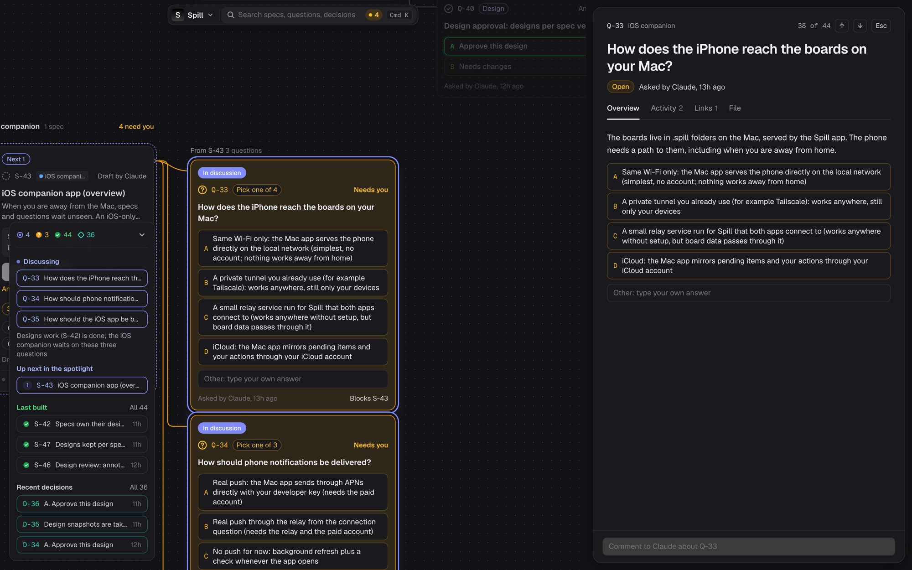
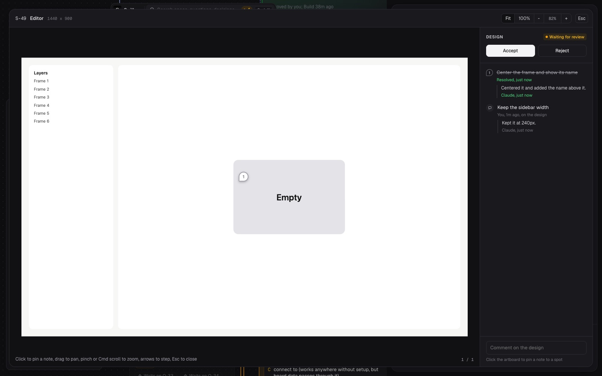
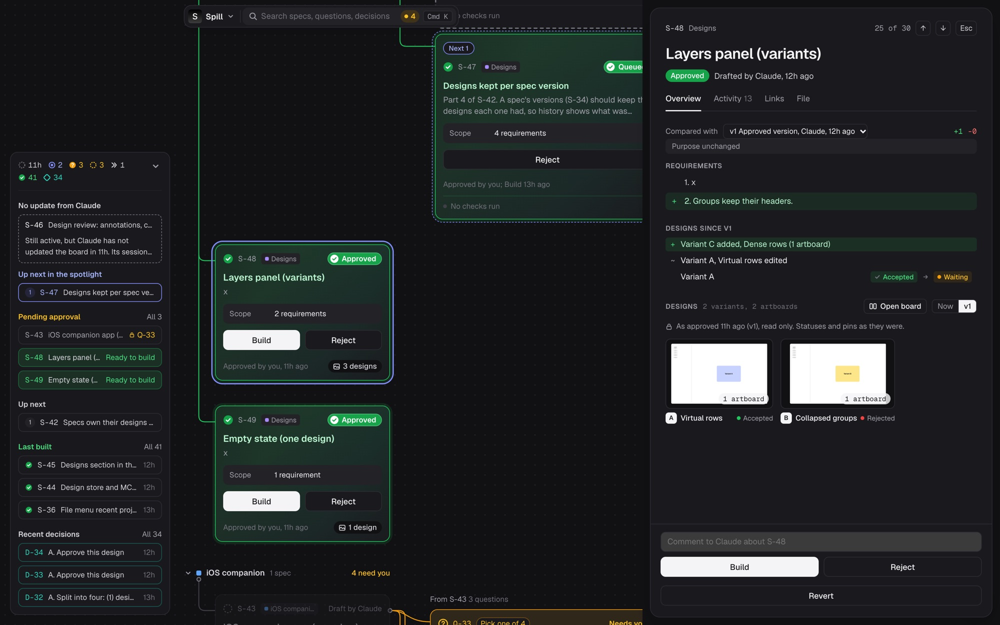

# Spill

Spill is a visual control center for a project's specs. Every question, spec and decision is a card on a canvas, colored by status, so you can see at a glance what is open, what is approved, what is being discussed and what Claude is building right now.

Claude reads and writes the board through the Spill MCP server, which this repo also builds. You review, answer, approve and build from the canvas (or the `spill` command); Claude picks up every change from its inbox.



## How it works

- **Specs before code.** Claude drafts a spec (purpose, numbered requirements, out of scope, acceptance checks) and builds nothing until you approve it and press **Build**.
- **Questions live on the board.** Anything Claude needs to know becomes a `Q-n` card with lettered options. Your answer is recorded as a `D-n` decision and unblocks the spec it was holding.
- **The board always matches reality.** A spec shows "Claude building" only while Claude is working on it. When Claude stops, the spec moves to done, to a blocking question, or back to discussing.
- **Everything is files.** The board is a `.spill/` folder in your project: one Markdown file per card plus an append-only event log. It diffs cleanly in git and still works without the app.

### Cards

| Kind     | ID      | What it is                                                         |
|----------|---------|--------------------------------------------------------------------|
| Section  | `SEC-n` | A group on the canvas (a feature or area).                         |
| Question | `Q-n`   | Something that must be answered before a spec is written or approved. |
| Spec     | `S-n`   | A testable requirement or feature. Code implements specs.          |
| Decision | `D-n`   | A recorded answer or trade-off, linked to the question it closes.  |

### Spec lifecycle

```
draft -> discussing -> approved -> queued -> active -> done
                    \-> rejected
```

Only you move a spec to `approved`, `queued` (Build) or `rejected`. The board can also approve a spec by itself when its last blocking question is answered or every child spec is done. You can revert an approved, queued, active or done spec back to discussing, or ask for an update on a done one.

## Features

### Canvas

- Cards grouped by section, with links drawn between specs, the questions that block them and the decisions that answered them.
- A summary panel with counts, what is being discussed now, what is up next (the spotlight Claude sets), pending approvals, recently built specs and recent decisions.
- Search across every card (Cmd K), keyboard navigation, collapsible sections, and cards that fade once they are settled.
- Light and dark themes, plus a Settings panel.



### Spec sheet

Opening a card shows it in full: overview, activity, links, the code Claude recorded for it, and the raw file. Specs keep a version history, so you can compare the current text with any earlier version and see what changed. Approve, Build, Reject, Revert and Update requests all happen here.



### Questions

Questions show their options right on the card. Pick one (or several for multi-choice questions), or type your own answer. An answer of your own is a redirect: Claude reads it and records it, drops the question, or rewrites it.



### Designs

UI specs own their designs. Claude draws artboards with the `spill_design_*` tools, and they render in the spec's Overview and in a larger canvas with zoom, pan and keyboard stepping. Designs render in a shadow root with scripts stripped, so they cannot affect Spill or run code.

- **Review in place.** Click an artboard to pin a note to a spot, comment on the whole design, and accept or reject it (or each variant) with a reason. Claude reads the feedback and replies on each pin.
- **Approval gate.** A spec with designs cannot be approved until a design (or a variant) is accepted.



- **Designs per version.** Approving a spec keeps a read-only copy of its designs, with their statuses and pins. Comparing with an approved version shows those designs and lists what changed since: variants added or removed, artboards edited, statuses changed.



### Desktop app

`spill app` opens the board in a native window (Tauri). One app process holds every project window; File > Open Recent and Open Project open other boards, and the Window menu lists the open ones.

## Requirements

- [Bun](https://bun.sh) 1.3 or later.
- For the desktop app: Rust and Cargo (Tauri 2). Without them, use `spill serve` and a browser.
- For design screenshots (`spill_design_screenshot`): macOS with `swiftc` (Xcode command line tools). The renderer is compiled on first use into `~/.spill/bin`.

## Setup

Install the `spill` command from a clone of this repo:

```bash
git clone https://github.com/tulburg/Spill.git
```

```bash
cd Spill && bun link
```

Give a project a board by creating a `.spill/` folder at its root with a `config.json` (copy [`.spill/config.json`](.spill/config.json) and change `project`) and a copy of [`.spill/SPILL.md`](.spill/SPILL.md), which tells Claude how to use the board. Spill finds the nearest `.spill/` folder from the current directory.

Connect Claude Code to the board by adding the server from [`.spill/mcp.example.json`](.spill/mcp.example.json) to the project's `.mcp.json`:

```json
{
  "mcpServers": {
    "spill": { "command": "spill", "args": ["mcp"] }
  }
}
```

Restart Claude Code; `spill_board` should return the board. Point Claude at `.spill/SPILL.md` from your `CLAUDE.md`.

## Usage

Open the board:

```bash
spill app
```

Or serve it for a browser (default port 4747):

```bash
spill serve
```

Every board action also works from the terminal:

```
spill board                     list every card
spill show ID                   one card in full
spill approve S-n [note]        approve a spec
spill build S-n                 queue an approved spec for Claude to build
spill reject S-n reason         reject a spec
spill revert S-n [reason]       take a spec back to discussing
spill answer Q-n text|A|A,C     answer a question (records a D-n)
spill comment ID text           comment on a card
spill ask "title" [body]        add a question for Claude
spill log [n]                   last n events (default 20)
spill focus                     what Claude is discussing now and next
spill message text [--file p]   message Claude, not about any card
spill app [port]                open the board in a Spill window
spill serve [port]              serve the board for a browser
spill mcp                       run the MCP server on stdio (for Claude)
```

## MCP tools

| Tool | What it does |
|------|--------------|
| `spill_inbox` | What you changed since Claude last looked: approvals, Build presses, rejections, reverts, answers, comments, messages, design feedback. |
| `spill_board`, `spill_get` | Read the whole board, or one card in full. |
| `spill_draft_spec`, `spill_update` | Draft a spec; edit a card's title, body or section. |
| `spill_ask`, `spill_record` | Ask a question (optionally blocking specs); record a decision. |
| `spill_set_status` | Move a card (never to approved, queued or rejected). |
| `spill_comment`, `spill_reply` | Comment on a card; answer a board-level message. |
| `spill_link`, `spill_unlink` | Link cards: blocks, answers, depends_on, follows. |
| `spill_focus` | Set the spotlight: what is discussed now and what is next. |
| `spill_checks`, `spill_files` | Record acceptance check results and the files a spec touched. |
| `spill_rejections`, `spill_propose_replace` | Work the rejection queue; propose replacing a done spec. |
| `spill_design_list`, `spill_design_create_artboard`, `spill_design_write_html`, `spill_design_read`, `spill_design_update_styles`, `spill_design_duplicate`, `spill_design_delete` | Draw and edit a spec's designs. |
| `spill_design_screenshot` | Render an artboard or node to PNG with WebKit. |
| `spill_design_feedback`, `spill_design_reply` | Read the review of a spec's designs; reply to pins and comments. |

## Board files

```
.spill/
  config.json        project name, statuses, limits
  SPILL.md           instructions for Claude
  cards/<ID>.md      one card per file: front matter (id, kind, title, status, section, links), body, comments
  events.jsonl       every change, from either side, appended
  state.json         ID counters and the inbox cursor
  checks.json        acceptance check results
  files.json         files recorded per spec
  versions/          spec text versions and approved design snapshots
  designs/S-n/       a spec's artboards and review feedback
  attachments/       files attached to messages and comments
```

Without the MCP server, Claude can edit the card files directly using the rules in `SPILL.md`; the app picks the changes up.

## Development

```
src/        CLI, board model, store, HTTP server, MCP server and tools, designs, renderer
ui/         the board UI (TypeScript, served by the board server)
src-tauri/  the desktop app shell
test/       bun tests
```

```bash
bun test
```

Spill builds itself with Spill: this repo's own specs, questions and decisions are in [`.spill/`](.spill/). See [`CLAUDE.md`](CLAUDE.md) for how Claude works in this repo.
